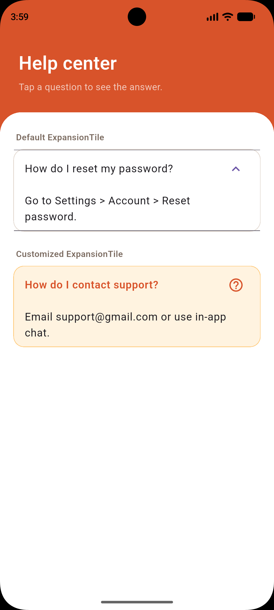

# ExpansionTile Demo

## What it is

`ExpansionTile` is a Material widget that expands and collapses a tile to reveal or hide its children.

## How to run

1. `git clone https://github.com/nakuwa23/expansion_tile_demo.git`
2. `cd expansion_tile_demo`
3. `flutter pub get`
4. `flutter run`

## Three attributes

### initiallyExpanded

- Default: `false`
- What I changed it to: `true`
- Effect: The customized tile is expanded when the app starts.
- Why a developer would change it: To show important or commonly needed content immediately.

### backgroundColor

- Default: `null` (the theme surface color)
- What I changed it to: `Color(0xFFFFF3E0)`
- Effect: The customized tile gets a light orange background while it is expanded.
- Why a developer would change it: To visually distinguish an open tile or match an app's visual design.

### trailing

- Default: The standard expand/collapse chevron icon.
- What I changed it to: `Icon(Icons.help_outline, color: Color(0xFFD8532A))`
- Effect: The customized tile displays a help icon instead of the default chevron.
- Why a developer would change it: To reinforce the meaning of the tile or provide a branded visual cue.

## Credits

Widget docs: https://api.flutter.dev/flutter/material/ExpansionTile-class.html

## Screenshot of the final UI

